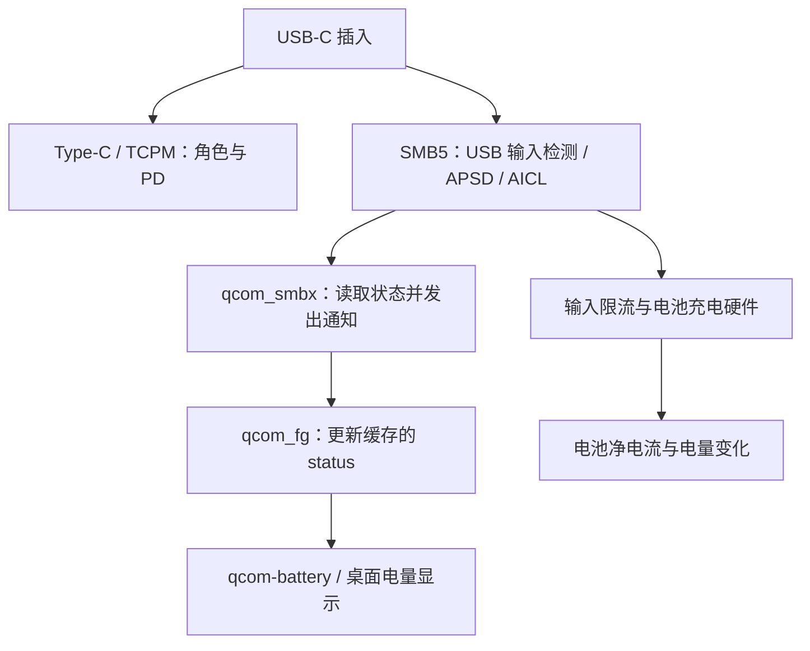

**nabu 插入电源后状态不更新／实际不充电：源码调查**

后续已进行实机采样，见 [电脑 USB 充电与 SLPI 日志调查](usb-charging-slpi-live-investigation.md)：区分了桌面净放电显示、Type-C/SMB5 限流脱节和 SMP2P 回归，并补充 ADC 标度修复。

调查日期：2026-10-24。仓库基线：`87331e1`。

结论：当前充电栈同时存在状态上报缺陷和 SMB5 硬件配置缺陷，不能把两个现象合并成“桌面图标没刷新”。其中若干错误可以直接由源码确定；哪条路径触发了某一次插入失败，仍需要失败当时的寄存器和事件记录。本次没有修改充电参数或驱动，也没有在 nabu 上复现。

**范围和核对方法**

- `sm8150-fork`：仓库固定的 `sm8150-mainline/linux` 标签 `v6.17.0-sm8150`。
- `mainline-latest`：Linux `v7.2.6` 加仓库的 [0005 充电补丁](../../pkgs/kernel/mainline-latest/patches/0005-power-supply-add-nabu-charging.patch)。下载原始文件后，抽出该补丁的 `qcom_smbx.c`、`qcom_fg.c` 两部分，以 `patch --fuzz=0` 应用成功。
- 两个版本的 `qcom_fg.c` 完全一致；`qcom_smbx.c` 的差别仅是 mainline 保留了一组未使用的宏和空行，函数实现一致。因此下述驱动问题同时存在于两个内核包。
- 寄存器编码以小米公开的 nabu Android 驱动交叉核对：[smb5-reg.h](https://github.com/MiCode/Xiaomi_Kernel_OpenSource/blob/nabu-r-oss/drivers/power/supply/qcom/smb5-reg.h)、[qpnp-smb5.c](https://github.com/MiCode/Xiaomi_Kernel_OpenSource/blob/nabu-r-oss/drivers/power/supply/qcom/qpnp-smb5.c)、[smb5-lib.c](https://github.com/MiCode/Xiaomi_Kernel_OpenSource/blob/nabu-r-oss/drivers/power/supply/qcom/smb5-lib.c)。这些是参考实现，不能代替本机寄存器实测。

下文 `qcom_smbx.c:L...` 使用 **应用补丁后的 mainline 文件行号**；`qcom_fg.c` 两个版本行号相同。便于在仓库内定位的位置另外给出补丁行号。此次临时源码位于 `/tmp/nabu-charger-audit/`。

现有 `dmesg.log` 只能确认加载了 `qcom-smbx-charger`，识别为 SMB5；没有能关联到一次失败插拔的 APSD、输入路径和充电状态记录。IDTP9418 是笔的无线供电驱动，不是这次 USB-C 给平板电池充电的主路径。

**两条独立链路**



TCPM 的“已连接／PD 合约成立”、charger 的 `online`、电池的 `status`、电池净电流是不同观测量。现有代码没有把 TCPM 协商结果完整接入 SMB5 的限流控制。

**1. 状态上报：电流符号的回退判断反了，缓存也不可靠**

`qcom_fg_gen3_get_current()`（L717–739）读取 PMIC 电流后取反，使导出的电池电流正值表示充电；PM8150B 的 `ops_fg_gen4` 复用这个函数。但是 `qcom_fg_get_property(STATUS)`（L893–935）在无 charger 引用或缓存为 `UNKNOWN` 时，仍把负电流判为 `Charging`、正电流判为 `Discharging`。

这是确定的代码内部矛盾。实际充电时，一旦走回退分支，就可能显示放电；放电时则可能显示充电。仓库位置：0005 补丁 L1878–1897、L2063–2094。

回退分支和缓存还存在以下问题：

- probe 注册 charger notifier 后**没有主动读取初始状态**。在收到下一次 charger 通知前，零初始化的 `status=UNKNOWN` 会让读取进入上述回退分支。
- 已有非 UNKNOWN 缓存时，读取电池 `status` 直接返回缓存，不重新读取 charger；电量变化 IRQ 和 `status_changed_work` 也只是发通知，不刷新这份缓存。
- notifier（L1121–1155）读取失败时先设置 `UNKNOWN`，随后无条件执行 `chip->status = propval.intval`。如果失败路径未写输出值，就使用了未初始化值；即使写了输出值，错误状态也会被覆盖。仓库位置：0005 补丁 L2281–2311。
- 电池注册配置只设置 `drv_data`，未设置 `fwnode`（L1224）。power-supply core 因而不会在这里建立 DT 的供应关系或执行其依赖检查。末尾仅查找一次 charger，找不到时可以继续成功且不注册 notifier，也不重试绑定。**这是防御不足，不能单凭它断言本机存在 probe 顺序竞争**：DT 的 `power-supplies` 仍可能由 `fw_devlink` 保证设备级依赖。

因此“电池电量仍更新，但插上电以后充电状态一直没变”完全可以发生在电池硬件仍工作的情况下。

**2. 插入处理：用 online 作前置条件，暂态失败后没有软件恢复保证**

`smb_handle_usb_plugin()`（L730）先发 `power_supply_changed()`，再安排 1500 ms 后运行 `smb_status_change_work()`（L489）。该任务入口是：

```c
smb_get_prop_usb_online(chip, &usb_online);
if (!usb_online)
    return;
```

这里的 `online` 读取 `0x110b`，要求 `USE_USBIN` 和 `VALID_INPUT_POWER_SOURCE` 都为 1；它不是 USB 物理插入位。若此时输入还在切换、处于 suspend/collapse，或者寄存器读取失败，任务直接结束，既不继续检测 APSD，也不重新安排工作。

只有 **online 已为真、APSD 返回 `-EAGAIN`** 时，代码才会在三次查询后重新触发 APSD，并于 1 秒后重试。不能把它概括成“APSD 完全没有重试”；真正的问题是重试覆盖范围不足。

进一步放大这个窗口的因素：

- `usbin-icl-change` handler（L742）只发通知，不安排配置任务。
- 驱动和设备树只接入 `usb-plugin`、`bat-ov`、`wdog-bark`、`usbin-icl-change` 四路 IRQ，没有 `usbin-src-change`（APSD 完成等）和 `chg-state-change`。参见 [DT 补丁](../../pkgs/kernel/mainline-latest/patches/0001-dt-qcom-sm8150-add-xiaomi-nabu.patch) L79–90。
- 插拔使用 `schedule_delayed_work()`，已 pending 时不会把执行时间移动到最新一次插入之后，因此快速拔插的 1500 ms 不一定从最新事件计时。
- 限流写入 `smb_set_current_limit()` 的返回值被忽略，写失败仍发“状态改变”通知；APSD rerun 的写入结果也未处理。

一个符合源码的失败序列是：插入 → 早期通知缓存了 Discharging → 延迟任务仍读到 online=0 后退出 → 硬件稍后稳定，却没有新通知刷新缓存或重新配置电流。它可解释状态滞留；若同时遗留输入限制/暂停状态，也可能解释实际不充电。**是否真的发生这个序列需要事件时间线验证**；硬件 AICL 的周期重试仍可能自行恢复，不能断言退出后必然永远不充电。

**3. 实际充电：SMB5 仍套用 SMB2 的电流和电压编码**

当前 `CURRENT_SCALE_FACTOR=25000`（L254），用于输入限流和快充电流配置。小米 `smb5_pm8150b_params` 明确规定这两项为 **50000 µA/LSB**；浮充电压为 **3.6 V 起、10 mV/LSB**，而当前 probe 使用 SMB2 的 3.4875 V、7.5 mV 公式（L1106）。

按当前源码和 nabu DT 的 4.48 V 配置计算：

| 项目 | 代码意图 | 实际写入 | 按 PM8150B 编码解释 |
| --- | --- | --- | --- |
| 快充电流 FCC | 1.95 A | `0x1061=0x4e` | 3.90 A 的设定码 |
| DCP/CDP 输入限流 | 1.50 A | `0x1370=0x3c` | 3.00 A 的设定码 |
| SDP 输入限流 | 0.50 A | `0x1370=0x14` | 1.00 A 的设定码，实际还受 USB 模式限制 |
| 浮充电压 FV | 4.48 V | `0x1070=0x85` | 超出厂商定义范围；正确设定码应为 `0x58` |

FV 的 `0x85` 按线性公式外推是 4.93 V，但已超过厂商参数最大值 4.79 V，**不能据此声称硬件真的输出了 4.93 V**。同样，电流设定码不等于实测电流，AICL、温控、供电能力等仍会限制它。

这些是确定的配置错误。较大的输入电流目标结合 collapse/suspend 策略，具有解释“某些电源或某次插入失败”的能力，但是否进入保护需要寄存器记录。修复优先级应高于仅延长插入等待时间。相关仓库位置：0005 补丁 L3218–3220、L3369–3370；电压公式在补丁前后均未按 SMB5 区分。

**4. 输入配置地址错误，SDP 的 500 mA 注释也不成立**

`USBIN_LOAD_CFG` 被定义为 `0x65`（L165），初始化加上 charger base `0x1000` 后访问 `0x1065`。厂商定义是 `USBIN_BASE + 0x65 = 0x1365`，所以本驱动的相对偏移应是 `0x365`。0005 补丁 L2744–2747 明确把原来的 `0x365` 改成了 `0x65`，fork 同样有此错误。

结果是初始化本想清除的 `ICL_OVERRIDE_AFTER_APSD` 根本没有在目标寄存器上被清除，输入限流模式可能继续受固件遗留状态影响。`0x1065` 上写操作的实际效果未确认。

此外，所谓“默认 500 mA USB 2.0”初始化仅设置 `USBIN_MODE_CHG_BIT`，没有设置 `USB51_MODE_BIT`，也没有确定 `CFG_USB3P0_SEL_BIT`。厂商 `set_sdp_current()` 明确用这些位选择 100/150/500/900 mA，并结合 ICL override 模式。当前 `smb_set_current_limit()` 只写 `0x1370`，不足以证明 SDP 的实际限流确实变为 500 mA。

这给“已识别插入，但输入功率很小，电池没有净充入”提供了另一条独立路径。不能仅凭 `current_max` 或日志中的目标值判断限流配置成功。

**5. SMB5 状态解码和过压读取存在确定错误**

当前 `enum charger_status`（L257）仍使用 SMB2 状态编号：

| 原始状态码 | nabu SMB5 的含义 | 当前驱动上报 |
| --- | --- | --- |
| `0` | INHIBIT_CHARGE | Charging（按 TRICKLE_CHARGE 解释） |
| `6` | PAUSE_CHARGE | Full（按 INHIBIT_CHARGE 解释） |
| `7` | DISABLE_CHARGE | Not charging |

这会直接产生“状态和实际充电不一致”，尤其是暂停时显示已充满。

`smbx_ov_status()`（L386）还有两层错误：SMB5 过压应读取 `0x1007` bit 1，当前却读 `0x100d`；最后返回的是 `!!(reg & mask)`，检查了寄存器地址而不是读回的 `val`。在当前 SMB5 分支中 `0x0d & BIT(1) == 0`，成功读取后永远不报告过压。只把 `reg` 改成 `val` 仍不正确，因为 `0x100d` bit 1 是温度相关状态。

这些错误主要破坏软件可见状态和诊断，不能说它们关闭了 PMIC 自身的硬件过压保护。仓库位置：0005 补丁 L2916–2939。

**6. 用户空间通知可能被 APSD 的暂态错误截断**

charger 的 `USB_TYPE` 属性直接调用 `smb_apsd_get_charger_type()`；online 但 APSD 未完成时返回 `-EAGAIN`。两个内核的 `power_supply_sysfs.c:add_prop_uevent()` 都只忽略 `-ENODEV/-ENODATA/-EINVAL`，`-EAGAIN` 会中断整个此次 charger uevent 的构造。

所以插入早期发出了 `power_supply_changed()`，并不意味着用户空间一定收到了 charger 的变化事件。此问题可以与第 2 项的任务退出叠加。内核 notifier 在 uevent 之前调用，因此不能进一步推断“FG 一定也没收到通知”；电池自身的 uevent 也应单独观察。

**7. Type-C/PD 与 SMB5 的配合不完整**

两版 `qcom_pmic_typec_port_set_vbus()` 都只处理向外供电的 regulator，未使用 `sink` 参数控制充电输入；回调表没有 `set_current_limit`。TCPM 会记录协商电流并更新自己的 power supply，但 qcom_smbx 没有消费这些值，仍只按 BC1.2 的 SDP/CDP/DCP 配置。

同时 SMB5 probe 仍写 Type-C 的 `0x1544/0x1546/...`，与独立 TCPM 驱动的职责重叠；VCONN 配置还误用 `SMB2_VCONN_EN_SRC_BIT`。这类冲突更偏向 probe／重新绑定阶段，不能直接解释每次普通热插拔。SMB5 初始化只打开 BC1.2 检测，也没有确定性清除未接管的 HVDCP 模式。

因此“TCPM 显示 PD 在线”不能证明 SMB5 已应用合约电流。应同时记录 Type-C 角色、TCPM power supply 和 SMB5 的输入状态。

**诊断数据也有陷阱**

- `smb_get_iio_chan()`（L541）在 charger 状态不是 Charging 时，直接返回电压/电流 0，根本不读 ADC。因此 `pm8150b-charger/voltage_now=0` 不是 VBUS 物理不存在的证据。
- `current_max` 读取 `0x1107` 并乘以 25 mA；厂商 PM8150B 的有效 AICL 限流读取 `0x1108`，步长 50 mA。现有属性不宜作为实际输入限流的唯一依据。
- `qcom-battery/current_now` 的正值按本驱动约定代表充入，负值代表放出。需要与负载和连续电量趋势一起看；该 Gen4 驱动复用了 Gen3 的换算，本次没有校准其幅度。

**修复顺序与最小验证**

1. 先修正 PM8150B 参数编码、USBIN_LOAD_CFG 地址、SMB5 状态编号和过压来源。这些不应依赖复现某次插入失败才确认。
2. 修复 FG 的错误处理和电流方向；建立明确供应关系、初始化状态，并保证后续读取/通知会刷新状态。补齐 notifier、引用、延迟工作的卸载清理后再做模块重绑实验；当前 FG remove 没有注销 notifier 和取消状态工作。
3. 以物理插入状态区分“拔出”和“输入尚未稳定”，接入 source/state-change IRQ，设计有界重试和恢复，处理每次寄存器写错误。不能无限强制解除所有 suspend，也不能把 PD/OTG 状态统一当作 DCP。
4. 最后补上 TCPM 与 charger 的限流协调，移走 charger 对 Type-C 端口的重复配置。

可以参考正在评审的 [SMB5 v4 系列](https://patchew.org/linux/20260820-submit-qcom-smbx-send-v1-v4-0-818dabb2771e@snyders.xyz/)：它已区分 PMIC 参数、修正状态解码，并将 Type-C/VBUS 控制交回独立驱动。邮件报告了另一台 PM8150B 设备的验证，不能当作 nabu 已验证，也不能直接宣称该系列已经合入当前内核。另一个 [charge-enable 顺序补丁](https://lkml.rescloud.iu.edu/2610.0/05336.html) 测试的是 PM660/SMB2，不应直接当作本机根因。

要区分一次实际失败，只需把以下观测放在同一时间线上：

| 观测 | 判别作用 |
| --- | --- |
| `qcom-battery/{status,current_now,capacity}` 与 charger `status` | 电池缓存滞留，还是 charger 自身状态异常 |
| `udevadm monitor --kernel --property --subsystem-match=power_supply` | charger 与 battery 的通知是否分别到达 |
| Type-C `power_role`、TCPM 的 online/current_max/usb_type | 是否实际成为供电端，PD 是否完成 |
| PMIC SID 2：`0x1310`、`0x110b`、`0x1340` | 物理插入、有效输入路径、USB suspend 是否分离 |
| `0x1307/0x1308`、`0x1365/0x1366/0x1370`、`0x1108` | APSD 结果、限流模式、配置值与有效限流 |
| `0x1006/0x1007/0x100d`、`0x1042/0x1043`、`0x1061/0x1070` | 充电阶段、故障/温度、enable/pause、实际设定码 |

应在插入前、失败后尚未重新拔插时、成功插入后各保留一组。寄存器可通过针对该 PMIC 的只读调试接口或临时驱动日志采集；不要用强写寄存器的恢复动作覆盖失败现场。若电池持续净放电，还需用低负载对照或外部测量区分输入功率不足与硬件完全未充电。

本次验证完成了两个内核的源码比对、充电补丁的零 fuzz 应用，以及按厂商参数重新计算设定码；没有进行内核构建、上板寄存器读取或硬件充电测试。因此结论是“已确认多处实现缺陷并定位可解释现象的路径”，而不是“已确认某一个缺陷是所有偶发失败的唯一原因”。

**后续候选补丁**

共用补丁 `0007-power-supply-fix-nabu-smb5-parameters-and-status.patch` 已接入两个内核包，修正电流/电压编码、USBIN_LOAD_CFG、有效 ICL 读取地址、SMB5 状态和过压读取、FG 电流方向/错误处理/实时状态读取及 notifier 清理，并避免 APSD 暂态错误中断 uevent。插入任务对 offline/读取失败增加最多五次、间隔一秒的恢复查询，最新插拔重新计时，不强制解除硬件 suspend。

尚未包括完整 TCPM 限流协调、新增 source/state IRQ、SDP 模式选择、ADC 标度修正或 Type-C 寄存器所有权重构。此补丁是供 CI 编译和真机回归的候选，不能视作所有充电故障已经解决。上文“未修改驱动”描述初次调查阶段。
